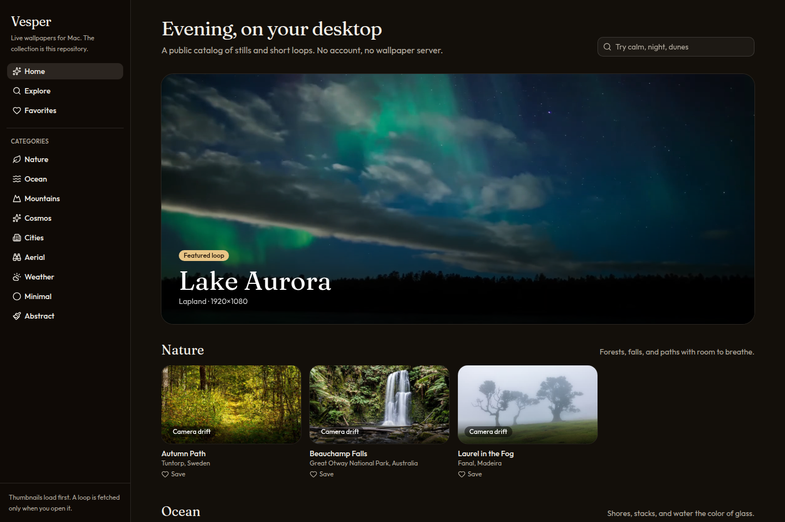
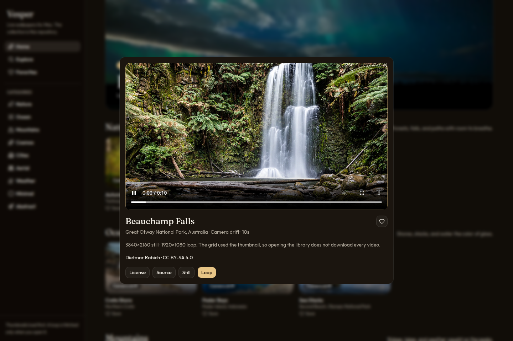

# Vesper

Live wallpapers for Mac. The collection lives in this repository, not on a wallpaper server.

Vesper is a native Swift app. It opens a library of high-resolution stills and short silent loops, shows a thumbnail first, and plays the one you choose behind your icons. Thumbnails are small on purpose, so the grid can appear before a single video is downloaded. There is no account, no feed, and no app that has to phone a private API to know what is in the library.



## What it does

- **A library you can scan.** Home, categories, search, and favorites. Search understands ordinary words such as `calm`, `night`, and `dunes`.
- **Thumbnails first.** Each wallpaper has a JPEG thumbnail, a still, and a short MP4. The grid loads the thumbnail. The loop is fetched when you preview or apply it.
- **A real desktop picture.** Apply sets the still with the system wallpaper API, so a picture remains if you quit Vesper, and the menu bar tint matches the scene. The loop plays in a borderless window behind the icons, on every Space.
- **One display, or all of them.** The preview names the screens macOS reports and can send a wallpaper to one of them.
- **Your own clips.** Drop in an MP4, MOV, or M4V. Vesper keeps a still and a thumbnail next to it and applies it the same way.
- **A menu bar that stays out of the way.** Pause, resume, or reopen the library without hunting for the window. Playback pauses on battery and Low Power Mode, and also when the Mac sleeps or the screen locks.
- **Favorites that can rotate.** Leave rotation off, or let a saved set change on a timer. Rotation uses files already on disk.

The app targets macOS 14 and later. It is Swift and AppKit, not a wrapped website.

## The collection

Nine categories, twenty-nine wallpapers. Most stills are 4K 16:9. Loops are 1080p, ten seconds, silent, and cut so the first and last frames meet.

| Category | What is in it |
| --- | --- |
| Nature | Autumn path, Beauchamp Falls, laurel fog in Fanal |
| Ocean | Crete shore, Second Beach sea stacks, Padar Island |
| Mountains | Maligne Lake, Verkhoyansk alpenglow, Denali |
| Cosmos | Milky Way, Rosette Nebula, Mývatn, a Lapland aurora, Earth from the ISS |
| Cities | Hong Kong harbour, Singapore, the Bund |
| Aerial | Teide above the clouds, Longsheng terraces, river mist |
| Weather | Litli-Hrútur, Kirkjufell, the Tatras |
| Minimal | Thar dunes, Namib, a coral pattern |
| Abstract | Afterglow, Veil, and Slow Dune, drawn for this project |

Two kinds of motion are labeled in the app:

- **Camera drift** is a slow pan across a still. It is an adaptation of the photograph, under the same license.
- **Footage** is a real clip. Lake Aurora and Earth at the Limb are footage. The abstract loops are original and released as CC0.

Open a wallpaper to see the author, the license, and a link back to the file. The full list is in [CREDITS.md](CREDITS.md).



## Put it on a Mac

You need macOS 14 or later, and either Xcode or the Command Line Tools (`xcode-select --install`).

```bash
git clone <this repository>
cd <this repository>
cd macos && ./scripts/build-app.sh
open dist/Vesper.app
```

The script compiles a release binary, copies `catalog/` into the app, and ad-hoc signs it. Drag `macos/dist/Vesper.app` to `/Applications` if you want it to launch at login.

The build is not notarized. The first time you open it, macOS may refuse a double-click. Right-click the app, choose **Open**, then **Open** again. There is no Homebrew cask.

GitHub Actions on `macos-14` runs the same script and uploads `Vesper.app` as a build artifact. That artifact is the same unsigned app.

### Point the app at GitHub

The copy you just built already contains the catalog, so it works with no network. Once this repository is public on GitHub, installed copies can refresh the library from the files in git.

1. Set `repository` in [`catalog/source.json`](catalog/source.json) to `owner/name`. Leave `branch` as `main` unless you publish elsewhere.
2. In the app, open **Settings** and enter the same `owner/name`, or the GitHub URL. **Refresh catalog** reads:

```text
https://raw.githubusercontent.com/<owner>/<name>/<branch>/catalog/manifest.json
```

Thumbnails, stills, and loops are the paths in that manifest, resolved against the `catalog/` folder. A file that is already in the app bundle or in `~/Library/Application Support/Vesper/Cache` is used as-is. Anything else is downloaded on preview or apply and kept in that cache. If GitHub is unreachable, the bundled catalog still opens.

## Browse the library in a browser

This repository also ships the same library as a small web app, for people who want to look before they build, and for sharing a category in a post.

```bash
npm install
npm run dev
```

The dev server listens on port **4731**. Thumbnails come from `catalog/` through a local route. Opening a wallpaper plays the loop. Favorites stay in the browser. **Still** and **Loop** download the files.

```bash
npm run build
npm start
```

## Add a wallpaper

A wallpaper is a folder plus one object in `catalog/manifest.json`.

```text
catalog/<category>/<slug>/
  thumb.jpg    about 640px wide, JPEG
  still.jpg    16:9, up to 3840×2160, JPEG
  loop.mp4     1920×1080, about 10 seconds, H.264, no audio, +faststart
```

Use a license that allows redistribution and adaptation: public domain, CC0, CC BY, or CC BY-SA. Skip NC and ND. A drift made from a still is a derivative, so it stays under the still’s license, and the entry should say who made the photograph. Keep `sourceUrl` pointed at the original file.

Then add the object next to the others. Paths are relative to `catalog/`:

```json
{
  "id": "ocean-example",
  "title": "Example Shore",
  "category": "ocean",
  "location": "Somewhere",
  "author": "Name",
  "license": "CC BY 4.0",
  "licenseUrl": "https://creativecommons.org/licenses/by/4.0",
  "sourceUrl": "https://commons.wikimedia.org/wiki/File:Example.jpg",
  "motion": "drift",
  "width": 3840,
  "height": 2160,
  "videoWidth": 1920,
  "videoHeight": 1080,
  "duration": 10,
  "tags": ["ocean", "calm"],
  "featured": false,
  "hero": false,
  "thumbnail": "ocean/example/thumb.jpg",
  "image": "ocean/example/still.jpg",
  "video": "ocean/example/loop.mp4"
}
```

`motion` is `drift`, `footage`, or `original`. One entry may set `"hero": true`. Commit the three files and the manifest. The Mac app picks them up on the next refresh. No server deploy.

The curated set can be rebuilt with `python3 scripts/gather_catalog.py` (ffmpeg, and network access to Wikimedia Commons). It keeps folders that already have a still, a thumbnail, and a loop, and it leaves `repository` in `source.json` alone.

## How a frame gets onto the desktop

1. The library asks for `manifest.json`.
2. The grid requests thumbnails only.
3. Preview downloads the loop if it is not local, then plays it muted, looping.
4. Apply writes the still as the desktop picture and opens the loop in a window one level below the icons. The window joins every Space, ignores the mouse, and cannot become key.
5. Sleep, the lock screen, battery, and Low Power Mode pause that window. Wake resumes it unless you paused it yourself.

## Questions people ask

**Does this replace the system wallpaper?** The still is the system wallpaper. The video is a window behind the icons. Quit the app and the still stays.

**Will it run on the lock screen?** No. The lock screen is a separate surface, and Vesper does not try to draw there. Playback pauses while the screen is locked.

**How heavy is a loop?** Each one is a 1080p, ten-second, silent H.264 file. The 4K still is what you see in the grid’s detail view and what macOS keeps as the picture.

**Can I use only my own videos?** Yes. Import them from **Your Videos**. They never leave the Mac.

**Why not a server?** So the library is just files. You can fork it, add a folder, and point the app at your fork. Anyone can see exactly which photograph a wallpaper came from.

## License

The app, the web library, and the scripts are [MIT](LICENSE). Photographs and footage are not. Read [CREDITS.md](CREDITS.md) before you reuse a file outside this project.
